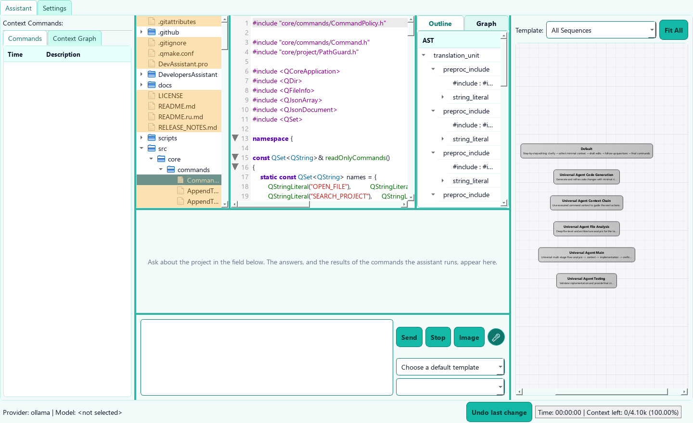
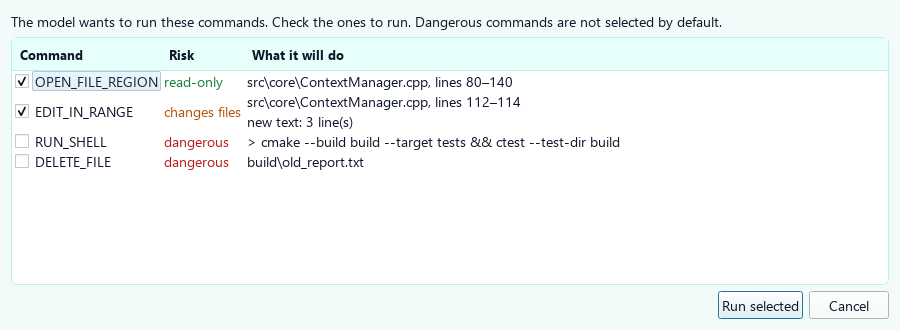
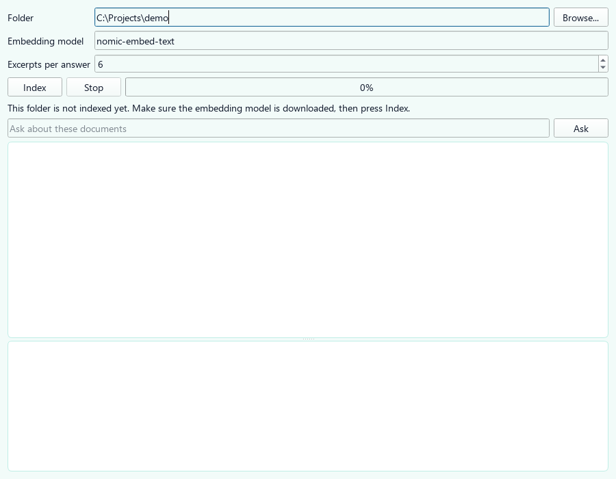
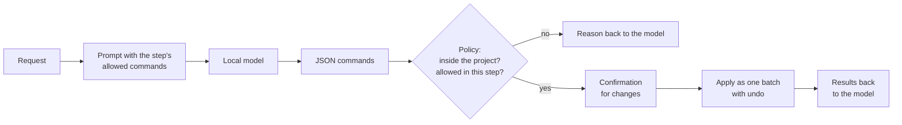

# DevAssistant

[](https://github.com/TonyLex98/DevAssistant/actions/workflows/build.yml)

**English** · [Русский](README.ru.md)

A desktop AI assistant for programmers that runs on **local models** and works on your
project through a fixed set of commands, so you always see what it is about to change.
Qt 5.15 / C++17, Windows.



## What it does

- **Works on the project through commands, not free-form edits.** The model answers with
  JSON commands — open a file region, edit a line range, apply a unified diff, search the
  project, run a shell command, ask the user — and DevAssistant executes them. 36 commands,
  see [docs/COMMANDS.md](docs/COMMANDS.md).
- **Safe by default.** Every path must stay inside the project folder; each step of a
  workflow lists the commands it may use; read-only commands run at once, and anything that
  changes files, runs a program or deletes is shown first with the exact command line, paths
  and line ranges. Changes are applied all-or-nothing and can be undone.
- **Local models.** Ollama or any OpenAI-compatible server (llama.cpp, LM Studio, vLLM).
- **Questions about your documents (RAG), written in C++.** Index a folder (code, notes,
  Markdown, PDF): chunks and their embeddings are stored in SQLite next to the project and
  updated incrementally; answers cite the excerpts they use. The agent can search the index
  itself with `SEARCH_DOCS`.
- **LightRAG client.** Upload documents to a LightRAG server, ask in its graph or vector
  modes and explore the knowledge graph.
- **Code insight.** Built-in editor with highlighting, the syntax tree from tree-sitter, and
  a project graph of classes, methods and calls across files (C/C++, Python, Dart).
- **Workflows.** Multi-step prompt sequences with per-step commands, grouped into solution
  templates; an optional agent mode plans each step with a separate model call.
- **Voice.** Dictate to the chat with faster-whisper, Vosk, whisper.cpp or a wav2vec2 model;
  have answers read aloud.
- **English and Russian interface.**

| Confirmation of the model's commands | Questions about documents |
|---|---|
|  |  |

## Quick start

1. Download `DevAssistant-…-windows-x64.zip` from
   [Releases](https://github.com/TonyLex98/DevAssistant/releases), unpack it and run
   `DevAssistantQt.exe`. Nothing to install.
2. Install [Ollama](https://ollama.com) and get a model, for example
   `ollama pull qwen2.5-coder:7b` (and `ollama pull nomic-embed-text` for document search).
   Another OpenAI-compatible server can be chosen in **Settings › Model**.
3. Open a project folder, pick the model in the chat and describe the task.

Voice input and text to speech are optional: they need Python 3.10+ and
`pip install -r scripts/requirements.txt`, then **Settings › Audio**.

## How a step works



More in [docs/ARCHITECTURE.md](docs/ARCHITECTURE.md).

## Building from source

Requirements: Qt 5.15 with MinGW 8.1 64-bit, Git, PowerShell.

```powershell
git clone https://github.com/TonyLex98/DevAssistant.git
cd DevAssistant
powershell -ExecutionPolicy Bypass -File scripts/fetch_tree_sitter.ps1
mkdir build; cd build
qmake ../DevAssistant.pro CONFIG+=release
mingw32-make -j4
mingw32-make check
```

This builds the core library, the program (`build/bin/DevAssistantQt.exe`) and the tests,
then runs the tests. `fetch_tree_sitter.ps1` downloads tree-sitter and the C++, Python and
Dart grammars at pinned commits. To build the Windows package:
`scripts/deploy_windows.ps1 -ExePath build/bin/DevAssistantQt.exe -Zip DevAssistant.zip`.

Tests (QtTest, 12 suites): the agent engine end to end with a scripted model on a temporary
project, the model client against a fake HTTP server, the session, path sandbox, command
parser and policy, file commands, change batches with undo, line-ending-preserving edits,
prompt data, the code indexer.

CI (GitHub Actions) builds, runs the tests, updates the Russian translation, packages the
zip, starts the program headless to take the screenshots above, and publishes releases.

## Project layout

| Folder | Contents |
|---|---|
| `src/core` | everything the assistant does, as a static library without QtWidgets: `session` (the session state), `model` (asynchronous model client), `workflow` (the agent engine, sequences, templates), `commands`, `context`, `project`, `code` (tree-sitter index), `rag`, `util` |
| `src/ui` | the main window, chat, dialogs, editor, graphs, document windows |
| `src/app` | `main()` and resources |
| `src/audio` | speech recognition engines, text to speech |
| `third_party` | md4c; tree-sitter is downloaded here |
| `tests` | QtTest suites, linked against the core library |
| `translations` | Russian translation |

The layers and the flow of one step are described in [docs/ARCHITECTURE.md](docs/ARCHITECTURE.md).

## License

MIT, see [LICENSE](LICENSE). Third-party components: [THIRD_PARTY_NOTICES.md](THIRD_PARTY_NOTICES.md).
