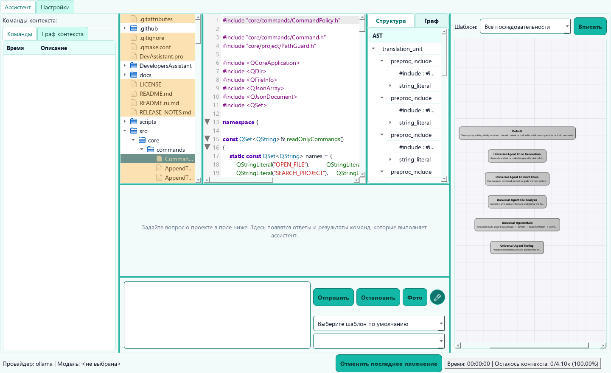
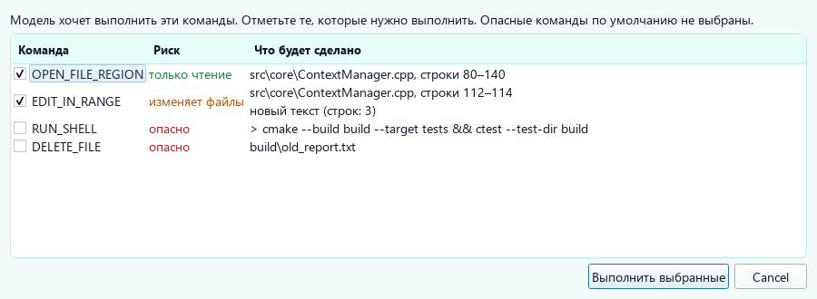
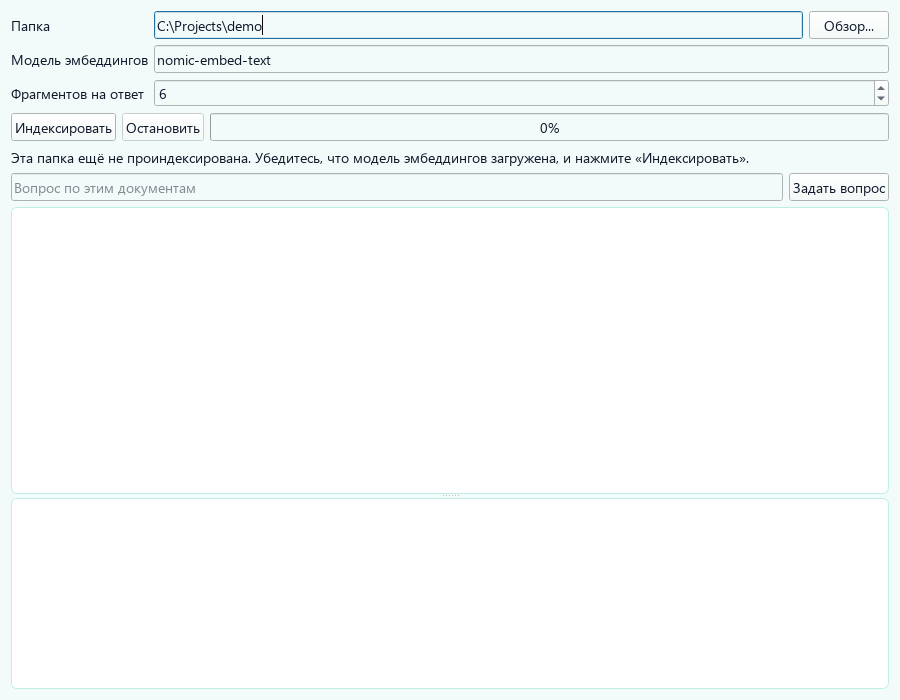
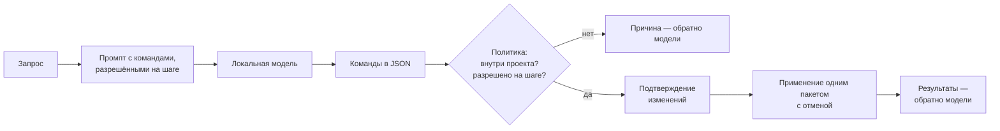

# DevAssistant

[](https://github.com/TonyLex98/DevAssistant/actions/workflows/build.yml)

[English](README.md) · **Русский**

Десктопный ИИ-ассистент программиста, который работает на **локальных моделях** и меняет
проект только через фиксированный набор команд — вы всегда видите, что именно он собирается
сделать. Qt 5.15 / C++17, Windows.



## Что умеет

- **Работает с проектом через команды, а не правит файлы как попало.** Модель отвечает
  командами в JSON — открыть фрагмент файла, заменить строки, применить патч, найти по
  проекту, выполнить команду оболочки, спросить пользователя, — а DevAssistant их выполняет.
  36 команд, список — [docs/COMMANDS.md](docs/COMMANDS.md).
- **Безопасен по умолчанию.** Любой путь должен оставаться внутри папки проекта; каждый шаг
  сценария перечисляет разрешённые ему команды; команды только для чтения выполняются сразу,
  а всё, что меняет файлы, запускает программы или удаляет, сначала показывается с точной
  командной строкой, путями и номерами строк. Изменения применяются целиком или никак и
  отменяются.
- **Локальные модели.** Ollama или любой сервер с OpenAI-совместимым API (llama.cpp,
  LM Studio, vLLM).
- **Вопросы по документам (RAG) — своя реализация на C++.** Папка (код, заметки, Markdown,
  PDF) индексируется: фрагменты и их эмбеддинги хранятся в SQLite рядом с проектом и
  обновляются только для изменённых файлов; ответ ссылается на использованные фрагменты.
  Агент сам ищет по индексу командой `SEARCH_DOCS`.
- **Клиент LightRAG.** Загрузка документов на сервер LightRAG, вопросы в его графовых и
  векторных режимах, просмотр графа знаний.
- **Понимание кода.** Встроенный редактор с подсветкой, синтаксическое дерево tree-sitter и
  граф проекта: классы, методы и вызовы между файлами (C/C++, Python, Dart).
- **Сценарии.** Многошаговые последовательности промптов со своими командами на каждом
  шаге, шаблоны решений; агентный режим планирует каждый шаг отдельным запросом к модели.
- **Голос.** Диктовка в чат через faster-whisper, Vosk, whisper.cpp или модель wav2vec2;
  озвучка ответов.
- **Интерфейс на русском и английском.**

| Подтверждение команд модели | Вопросы по документам |
|---|---|
|  |  |

## Быстрый старт

1. Скачайте `DevAssistant-…-windows-x64.zip` в
   [Releases](https://github.com/TonyLex98/DevAssistant/releases), распакуйте и запустите
   `DevAssistantQt.exe`. Устанавливать ничего не нужно.
2. Установите [Ollama](https://ollama.com) и скачайте модель, например
   `ollama pull qwen2.5-coder:7b` (и `ollama pull nomic-embed-text` для поиска по документам).
   Другой OpenAI-совместимый сервер выбирается в **Настройки › Модель**.
3. Откройте папку проекта, выберите модель в чате и опишите задачу.

Голосовой ввод и озвучка необязательны: нужен Python 3.10+ и
`pip install -r scripts/requirements.txt`, затем **Настройки › Аудио**.

## Как устроен один шаг



Подробнее — [docs/ARCHITECTURE.md](docs/ARCHITECTURE.md) (на английском).

## Сборка из исходников

Нужны Qt 5.15 с MinGW 8.1 64-bit, Git и PowerShell.

```powershell
git clone https://github.com/TonyLex98/DevAssistant.git
cd DevAssistant
powershell -ExecutionPolicy Bypass -File scripts/fetch_tree_sitter.ps1
mkdir build; cd build
qmake ../DevAssistant.pro CONFIG+=release
mingw32-make -j4
mingw32-make check
```

Собираются библиотека ядра, программа (`build/bin/DevAssistantQt.exe`) и тесты, затем
тесты запускаются. `fetch_tree_sitter.ps1` скачивает tree-sitter и грамматики C++, Python и
Dart на закреплённых коммитах. Архив для Windows:
`scripts/deploy_windows.ps1 -ExePath build/bin/DevAssistantQt.exe -Zip DevAssistant.zip`.

Тесты (QtTest, 12 наборов): движок агента целиком — со сценарной моделью на временном
проекте, клиент модели — против поддельного HTTP-сервера, состояние сессии, песочница путей,
разбор и политика команд, файловые команды, пакеты изменений с отменой, правки с сохранением
переводов строк, данные промптов, индексатор кода.

## Устройство

- `src/core` — вся логика ассистента, статическая библиотека без QtWidgets: состояние
  сессии, асинхронный клиент модели, движок агента, команды, контекст, проект, индекс кода,
  поиск по документам. Подключить виджет сюда нельзя — сборка упадёт.
- `src/ui` — главное окно, чат, диалоги, редактор, графы. Окно только собирает виджеты и
  связывает их с сессией и движком.
- `src/app` — `main()`; `src/audio` — распознавание и синтез речи; `third_party` — сторонний код.

CI (GitHub Actions) собирает программу, гоняет тесты, обновляет русский перевод, упаковывает
архив, запускает программу без экрана, чтобы снять скриншоты выше, и публикует релизы.

## Лицензия

MIT, см. [LICENSE](LICENSE). Сторонние компоненты — [THIRD_PARTY_NOTICES.md](THIRD_PARTY_NOTICES.md).
