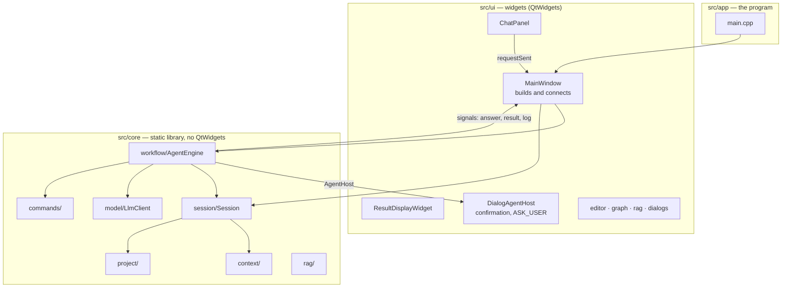
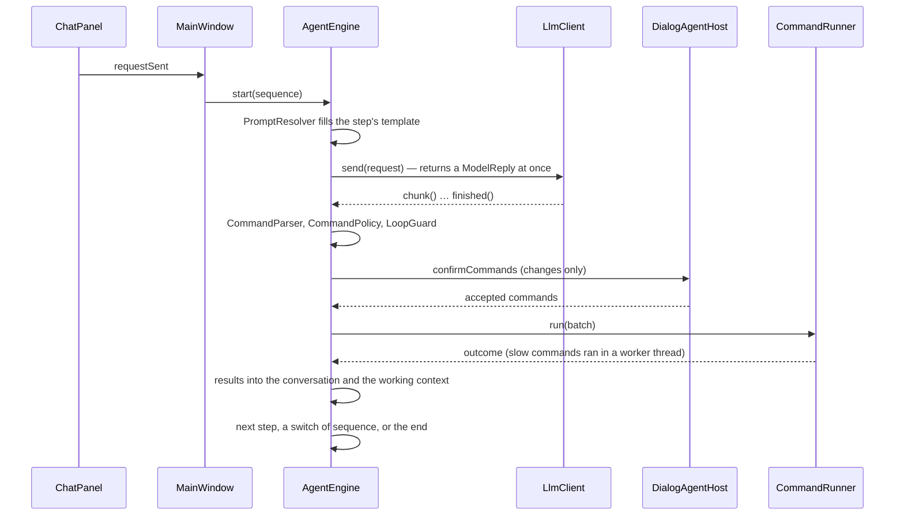

# Architecture

DevAssistant is a Qt 5.15 / C++17 desktop program. A language model (Ollama or any
OpenAI-compatible server) works on a project folder through a fixed set of JSON commands;
the program decides what the model may do, shows the user what will change, applies the
changes and feeds the results back to the model.

## Layers

- **`src/core`** is everything the assistant does, built as a static library
  (`src/core/core.pro`) with `QT = core gui network sql`. QtWidgets is not linked, so a
  widget header included by mistake fails the build: the logic stays testable and the user
  interface replaceable. The tests link this library.
- **`src/ui`** only shows things and passes the user's actions on. `MainWindow` owns a
  `Session` and an `AgentEngine`, builds the widgets with `UiBuilder` and connects them.
- **`src/app`** holds `main()`: command-line modes, translations, the screenshot mode used by CI.
- **`src/audio`** is the speech recognition and text-to-speech engines (QtMultimedia).
- **`third_party`** is md4c (in the repository) and tree-sitter (downloaded at pinned commits).

## The core

| Folder | Contents |
|---|---|
| `session/` | `Session`: the project, the conversation, the working context, the workflow library, the model and the current run (`RunState`). `Conversation`: requests, answers, notes, attached images. |
| `model/` | `ModelClient` (the interface), `ModelRequest`, `ModelReply` (one request in flight: `chunk()`, `finished()`, `abort()`), `LlmClient` (Ollama `/api/chat` and OpenAI-compatible `/v1/chat/completions`, streaming, timeouts, API key, model list). |
| `workflow/` | `AgentEngine` (runs the sequences), `CommandRunner` (runs a batch; slow commands in a worker thread), `LoopGuard` (stops runs that go in circles), `AgentHost` (what the engine needs from the user), `WorkflowLibrary` (sequences and templates on disk, finding them by name), `BuiltinWorkflows`, prompt sequences and solution templates. |
| `commands/` | the 36 commands, `CommandParser`, `CommandRegistry`, `CommandDocs`, `CommandPolicy`. |
| `context/` | `WorkingContext` (command history, opened files, program output, search results; watches the opened files), `ContextManager` (the command history and its topic graph), `FileContext`, `PromptResolver` (fills the templates' placeholders from the session). |
| `project/` | `Project` (the folder, its files, structure and descriptions), `DevAssManager` (changes with checks and undo), `ChangeApplier`, `PathGuard`, `TextFileLines`, `DescriptionGenerator`. |
| `code/` | `ProjectIndexer` (tree-sitter: classes, methods, fields, calls for C/C++, Python, Dart), `CodePatcher`. |
| `rag/` | document search: SQLite store, chunking, embeddings, the index (worker thread); the LightRAG client. |
| `util/` | settings (`AppConfig`), logging categories, JSON helpers. |

## One step of work

1. **Sequences.** Work is organised in prompt sequences (`*.seq.json`): each step has a
   prompt template and the list of commands allowed in that step. Solution templates group
   sequences and the links between them; the model can switch sequences with
   `OPEN_SEQUENCE` / `CALL_SEQUENCE`, and `WorkflowLibrary::find` resolves the name it gives.
2. **Prompt.** `PromptResolver` fills the template's placeholders (below) from the session
   and appends the documentation of the allowed commands, generated from `CommandDocs`.
3. **Model.** `LlmClient::send` returns a `ModelReply` at once; the answer arrives through
   its signals. Nothing waits in a nested event loop, so the window stays responsive and
   "Stop" works at any moment. Each run has a number: answers that arrive for a stopped run
   are dropped.
4. **Parsing.** `CommandParser` accepts a JSON array, single objects, objects inside prose
   or Markdown fences, and repairs common model mistakes (smart quotes, trailing commas,
   bare keys). As a last resort it reads one-line commands such as
   `OPEN_FILE path=src/main.cpp`, but only for upper-case names of registered commands, so
   ordinary sentences never become commands.
5. **Policy.** `CommandPolicy` gives every command a risk level (read-only, modifying,
   dangerous), rejects any path parameter outside the project folder (`PathGuard`, with
   canonical paths so `..` and symlinks cannot escape) and any modifying or dangerous
   command that the current step does not allow. The model is told why.
6. **Confirmation.** By default read-only batches run at once; anything that changes files,
   runs a program or deletes goes through `AgentHost::confirmCommands`, which the window
   shows as `CommandConfirmDialog` with the actual command line, paths and line ranges.
7. **Running.** `CommandRunner` runs the batch in order. Commands that wait on a process or
   the network (`RUN_SHELL`, `RUN_PYTHON`, `GIT_*`, `SEARCH_*`) run in a worker thread.
   File commands produce `Change`s that `DevAssManager` checks against the project folder
   once more and `ChangeApplier` applies as one batch, with undo (50 steps). Text edits keep
   the file's encoding, line endings and final newline (`TextFileLines`).
8. **Context.** Results go to the conversation and to `WorkingContext`; files that a
   command changed, or that change on disk, are dropped from the context.
9. **Loops.** `LoopGuard` ends a run that gives no usable commands for several steps, only
   searches and reads, or repeats itself; the user then gets a summary of what was found.
   In agent mode a step that changed nothing although the user asked for changes is retried
   once with a repair prompt.

## Placeholders in prompt templates

| Placeholder | Filled with |
|---|---|
| `{{USER_QUERY}}`, `{{LAST_USER_MESSAGES}}` | the user's request, the recent user messages |
| `{{HISTORY}}`, `{{LAST_ASSISTANTS_RESPONSE}}`, `{{PREVIOUS_STEPS}}` | the conversation, the model's last answer, what the previous steps did |
| `{{PROJECT_ROOT}}`, `{{FILE_LIST}}`, `{{PROJECT_STRUCTURE}}`, `{{FILE_DESCRIPTIONS}}` | the project folder, its files, its tree, short file descriptions |
| `{{OPEN_FILES}}`, `{{SEARCH_RESULTS}}`, `{{CONTEXT_CHAIN}}` | the files and lines opened (numbered), program output and search results, the executed commands with their state |
| `{{SUPPORTED_COMMANDS}}`, `{{OPEN_SEQUENCE_INFO}}` | documentation of the commands allowed in this step, sequences that can be opened next |
| `{{CURRENT_DATE}}`, `{{TODAY}}`, `{{CURRENT_DATETIME}}`, `{{TOKEN_COUNT}}` | date and time, approximate size of the context |

A placeholder is computed only when the template uses it; unknown placeholders are removed.

## Adding a command

1. Subclass `Command` (`src/core/commands`): `name()`, `params()`, `apply()`, `getResult()`.
   Write files only through `DevAssManager::applyChanges` so the change is checked, can be
   undone and keeps encodings. If the command waits on a process or the network, return
   `true` from `runsInBackground()` and do not touch the files through `DevAssManager`.
2. Register it in `CommandRegistry` (the factory and `all()`), with aliases if models tend
   to use other names.
3. Describe it in `CommandDocs`: summary, parameters, an example. This is what the model
   reads and what `docs/COMMANDS.md` is generated from.
4. Give it a risk level in `CommandPolicy`; if it has a path parameter with a new name, add
   the name to `pathParamNames()`.
5. Add tests in `tests/`.

## Tests

`tests/` holds 12 QtTest suites that link the core library. Besides the units (path checks,
the parser and the policy, file commands, change batches, line-ending-preserving edits, the
code index), three cover the new structure end to end:

- `tst_agentengine` runs sequences with a scripted model (`tests/ScriptedModel.h`) and a
  scripted user on a temporary project: changes, rejected paths, declined commands,
  `ASK_USER`, stopping, the plain chat, model errors.
- `tst_llmclient` talks to a fake HTTP model server (`tests/FakeModelServer.h`): request
  bodies of both protocols, whole and streamed answers, errors, timeouts, cancellation.
- `tst_session`: the conversation, the loop guard, finding sequences, filling prompts, the
  project and the working context.

## Where things are stored

- Settings: `QSettings` (Windows registry), keys such as `model/*`, `rag/*`, `speech/*`,
  `agent/enabled`, `commandConfirmMode`, `ui/language`.
- Prompt sequences and solution templates: `Documents/DevelopersAssistant/`.
- Per project: `<project>/DevelopersAssistant/` (file descriptions, the document index).

## Building and CI

`DevAssistant.pro` builds the core library, the program and the tests; settings shared by
all three are in `.qmake.conf` and `src/devassistant.pri`. The program lands in `bin/`, the
library in `lib/` (of the build folder).

`.github/workflows/build.yml` builds with Qt 5.15.2 and MinGW 8.1 on Windows, runs the
tests, updates the Russian translation (`lupdate`, then `scripts/fill_translations.py` from
`translations/ru/*.json`), packages a zip with `scripts/deploy_windows.ps1`, starts the
packaged program headless to take the screenshots in `docs/screenshots`, and publishes a
release for `v*` tags.
