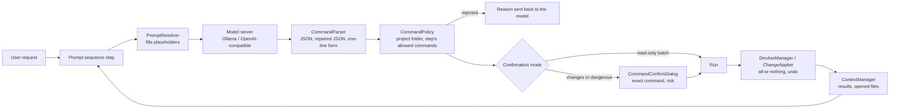

# Architecture

DevAssistant is a Qt 5.15 / C++17 desktop program. A language model (Ollama or any
OpenAI-compatible server) works on a project folder through a fixed set of JSON commands;
the program decides what the model may do, shows the user what will change, applies the
changes and feeds the results back to the model.

## One step of work

1. **Sequences.** Work is organised in prompt sequences (`*.seq.json`): each step has a
   prompt template and the list of commands allowed in that step. Solution templates group
   sequences and the links between them; the model can switch sequences with
   `OPEN_SEQUENCE` / `CALL_SEQUENCE`.
2. **Prompt.** `PromptResolver` fills the template's placeholders (below) and appends the
   documentation of the allowed commands, generated from `CommandDocs`.
3. **Parsing.** `CommandParser` accepts a JSON array, single objects, objects inside prose
   or Markdown fences, and repairs common model mistakes (smart quotes, trailing commas,
   bare keys). As a last resort it reads one-line commands such as
   `OPEN_FILE path=src/main.cpp`, but only for upper-case names of registered commands, so
   ordinary sentences never become commands. `CommandRegistry` maps aliases and parameter
   names to the canonical command and converts "2" / "true" to numbers and flags.
4. **Policy.** `CommandPolicy` gives every command a risk level (read-only, modifying,
   dangerous), rejects any path parameter outside the project folder (`PathGuard`, with
   canonical paths so `..` and symlinks cannot escape) and any modifying or dangerous
   command that the current step does not allow. The model is told why.
5. **Confirmation.** By default read-only batches run at once; anything that changes files,
   runs a program or deletes is shown in `CommandConfirmDialog` with the actual command line,
   paths and line ranges, built from the parameters rather than from the model's own
   description. Dangerous commands start unchecked.
6. **Applying.** File commands produce `Change`s that `DevAssManager` checks against the
   project folder once more and `ChangeApplier` applies as one batch: if a change fails, the
   batch is rolled back. Each batch is an undo step (up to 50). Text edits keep the file's
   encoding (UTF-8, BOM), line endings and final newline (`TextFileLines`).
7. **Context.** Results, opened files and search hits go to `ContextManager` and the model's
   history, and the next step starts.

## Modules

| Folder | Contents |
|---|---|
| `src/core` | `DevAssManager` (project root, changes, file descriptions), `ChangeApplier`, `ContextManager`, `PromptResolver`, prompt sequences and solution templates |
| `src/command` | the 36 commands, `CommandParser`, `CommandRegistry`, `CommandDocs`, `CommandPolicy`, `CommandConfirmDialog` |
| `src/adapters` | `OllamaAdapter`: chat and streaming for Ollama and OpenAI-compatible servers, timeouts and errors |
| `ragmodule` | document search: `Store` (SQLite), `chunkText`, `Embedder`, `Index` (worker thread), the Documents window |
| `src/codeviewer` | `ProjectIndexer` (tree-sitter: classes, methods, fields, call edges for C/C++, Python, Dart), project graph, sequence workflow graph |
| `src/uiide` | the built-in editor: highlighting, syntax tree view, method editing |
| `src/audio` | `SpeechRecognizer` with four engines (faster-whisper, Vosk, whisper.cpp, Omni ASR) and text to speech |
| `src/ui` | main window, chat, settings, LightRAG client, controllers (`SequenceRunner` runs the steps) |
| `src/utils` | `PathGuard`, `TextFileLines`, JSON helpers, settings |
| `scripts` | Python servers for voice, packaging and tree-sitter download |
| `tests` | QtTest suites, run in CI |

## Document search (RAG)

`Rag::Index::startIndexing(folder)` walks the folder in a worker thread, extracts text
(text and code files as UTF-8, PDF through `pdftotext`), cuts it into overlapping chunks at
paragraph, line, sentence or word boundaries, gets embeddings in batches from the model
server (`/api/embed` or `/v1/embeddings`) and stores them in
`<folder>/DevelopersAssistant/rag.sqlite`. Unchanged files are skipped on the next run and
deleted files are dropped. A question is embedded the same way; the closest chunks by cosine
similarity go to the chat model with numbered citations. The model can search the index
itself with `SEARCH_DOCS`.

## Placeholders in prompt templates

| Placeholder | Filled with |
|---|---|
| `{{USER_QUERY}}`, `{{LAST_USER_MESSAGES}}` | the user's request, the recent user messages |
| `{{HISTORY}}`, `{{LAST_ASSISTANTS_RESPONSE}}`, `{{PREVIOUS_STEPS}}` | the conversation, the model's last answer, what the previous steps did |
| `{{PROJECT_ROOT}}`, `{{FILE_LIST}}`, `{{PROJECT_STRUCTURE}}`, `{{FILE_DESCRIPTIONS}}` | the project folder, its files, its tree, short file descriptions |
| `{{OPEN_FILES}}`, `{{SEARCH_RESULTS}}`, `{{CONTEXT_CHAIN}}` | content opened with `OPEN_FILE`, search hits, the chain of related context |
| `{{SUPPORTED_COMMANDS}}`, `{{OPEN_SEQUENCE_INFO}}` | documentation of the commands allowed in this step, sequences that can be opened next |
| `{{CURRENT_DATE}}`, `{{TODAY}}`, `{{CURRENT_DATETIME}}`, `{{TOKEN_COUNT}}` | date and time, approximate size of the context |

## Adding a command

1. Subclass `Command` (`src/command`): `name()`, `params()`, `apply()`, `getResult()`.
   Write files only through `DevAssManager::applyChanges` so the change is checked, can be
   undone and keeps encodings.
2. Register it in `CommandRegistry` (the factory and `all()`), with aliases if models tend
   to use other names.
3. Describe it in `CommandDocs`: summary, parameters, an example. This is what the model
   reads and what `docs/COMMANDS.md` is generated from.
4. Give it a risk level in `CommandPolicy`; if it has a path parameter with a new name, add
   the name to `pathParamNames()`.
5. Add tests in `tests/`.

## Where things are stored

- Settings: `QSettings` (Windows registry), keys such as `model/*`, `rag/*`, `speech/*`,
  `agent/enabled`, `commandConfirmMode`, `ui/language`.
- Prompt sequences and solution templates: `Documents/DevelopersAssistant/`.
- Per project: `<project>/DevelopersAssistant/` (file descriptions, the document index).

## Building and CI

`.github/workflows/build.yml` builds with Qt 5.15.2 and MinGW 8.1 on Windows, runs the
tests, updates the Russian translation (`lupdate`, then `scripts/fill_translations.py` from
`translations/ru/*.json`), packages a zip with `scripts/deploy_windows.ps1`, starts the
packaged program headless to take the screenshots in `docs/screenshots`, and publishes a
release for `v*` tags.
